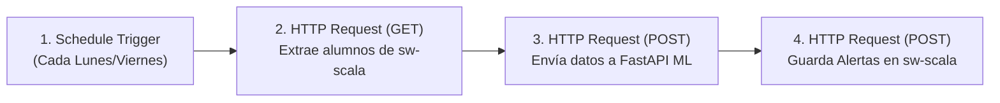

# 📚 Guía de Estudio e Implementación: Servicio Externo de Machine Learning y Automatización con n8n

Este documento reúne todo lo que necesitas estudiar, instalar y comprender para construir el **Repositorio Externo de IA/ML (Python + FastAPI + Scikit-Learn)** y los **Flujos de Automatización en n8n** que se conectarán con `sw-scala`.

---

## 🧠 PARTE 1: El Microservicio de Machine Learning (Python + FastAPI)

### 1. ¿Qué problema resuelve exactamente tu modelo?
Tu modelo resuelve un problema de **Clasificación Supervisada Multiclase** (o predicción de probabilidad de riesgo):
* **Entrada ($X$ — Features):** Métricas académicas de un alumno en una inscripción activa.
* **Salida ($y$ — Target):**
  * **Nivel de Riesgo:** `BAJO`, `MEDIO`, `ALTO`.
  * **Score / Probabilidad:** `0.0` a `100.0%`.
  * **Factores de Riesgo (Explicabilidad):** Qué porcentaje de culpa tiene cada variable (ej. 60% por inasistencias, 30% por bajas notas en prácticas, 10% por atrasos).

---

### 2. Conceptos Clave que debes investigar para tu Defensa de Grado

1. **Algoritmo Recomendado: Random Forest Classifier (`scikit-learn`)**
   * **¿Por qué elegir Random Forest para tu tesis?**
     * Funciona excelente con conjuntos de datos tabulares pequeños y medianos (100 a 5,000 registros).
     * No sufre fácilmente de *overfitting* (sobreajuste).
     * Entrega de forma nativa **`feature_importances_`** (la importancia de cada variable) y **`predict_proba()`** (el porcentaje exacto de riesgo de cada estudiante).
2. **Variables de Entrada (Features del Estudiante):**
   Estas son las 6 variables exactas que `sw-scala` envía al microservicio:
   * `porcentaje_asistencia` (float, 0 a 100): Porcentaje global de asistencia.
   * `faltas_injustificadas` (int): Total de faltas acumuladas.
   * `atrasos` (int): Total de llegadas tarde.
   * `promedio_calificaciones` (float, 0 a 100): Promedio ponderado en evaluaciones.
   * `tendencia_notas` (float): Diferencia entre la última evaluación y las anteriores (negativo si está bajando su rendimiento).
   * `observaciones_negativas` (int): Cantidad de observaciones de tipo `DISCIPLINA` o `RECOMENDACION` crítica.
3. **Métricas de Evaluación del Modelo (Para defender ante el tribunal):**
   * **Accuracy (Exactitud):** Porcentaje total de aciertos del modelo.
   * **Recall (Sensibilidad):** ¡La métrica más importante en educación! Mide qué tan bueno es el modelo detectando a los alumnos que realmente estaban en riesgo sin dejar escapar a ninguno.
   * **F1-Score:** Media armónica entre *Precision* y *Recall*.
4. **Serialización del Modelo (`joblib`):**
   * Una vez entrenado el modelo en Python, se guarda en un archivo `.pkl` o `.joblib` (`joblib.dump(model, 'modelo_scala_v1.pkl')`).
   * FastAPI carga ese archivo en memoria al iniciar y responde predicciones en menos de 20 milisegundos.

---

### 3. Estructura Mínima del Repositorio Externo (`scala-ml-service`)

Cuando crees tu repositorio aparte en Python, solo necesitarás esta estructura:

```text
scala-ml-service/
├── app/
│   ├── main.py            # Servidor FastAPI y endpoints
│   ├── schemas.py         # Esquemas Pydantic de entrada/salida
│   └── predictor.py       # Carga del modelo .pkl y cálculo de factores
├── training/
│   ├── generar_dataset.py # Genera datos históricos sintéticos + reales para entrenar
│   └── train_model.py     # Entrena el RandomForest y guarda modelo_scala_v1.pkl
├── models/
│   └── modelo_scala_v1.pkl
└── requirements.txt       # fastapi, uvicorn, scikit-learn, pandas, numpy, joblib
```

---

### 4. Contrato JSON entre `sw-scala` (Laravel) y `scala-ml-service` (FastAPI)

Este es el formato exacto que `sw-scala` enviará a tu servidor de Python en `POST http://127.0.0.1:8001/api/v1/predict`:

#### 📥 Lo que envía `sw-scala` (Request):
```json
{
  "inscripcion_id": 5,
  "alumno_codigo": "ALU-006",
  "features": {
    "porcentaje_asistencia": 58.3,
    "faltas_injustificadas": 3,
    "atrasos": 2,
    "promedio_calificaciones": 62.5,
    "tendencia_notas": -8.5,
    "observaciones_negativas": 2
  }
}
```

#### 📤 Lo que debe responder tu FastAPI (Response):
```json
{
  "nivel_riesgo": "ALTO",
  "score_riesgo": 78.5,
  "version_modelo": "v1.1.0",
  "factores_riesgo": [
    {
      "factor": "Baja asistencia acumulada (58.3%)",
      "impacto": 45,
      "categoria": "ASISTENCIA"
    },
    {
      "factor": "Promedio de evaluaciones en zona límite (62.5 pts)",
      "impacto": 35,
      "categoria": "ACADEMICO"
    },
    {
      "factor": "Tendencia descendente en últimas prácticas (-8.5 pts)",
      "impacto": 20,
      "categoria": "EVOLUCION"
    }
  ],
  "resumen_explicativo": "Riesgo ALTO detectado principalmente por inasistencias reiteradas y caída en evaluaciones prácticas."
}
```

---

## ⚙️ PARTE 2: Automatización con n8n (HU19)

### 1. ¿Qué es n8n y cuál es su rol en tu arquitectura?
* **n8n** es un orquestador visual de flujos de trabajo (*workflow automation*).
* **Regla de oro para tu defensa:** n8n **NO** calcula el Machine Learning; n8n es el **"director de orquesta"** que se despierta automáticamente (por ejemplo, todos los viernes a las 20:00), pide los datos a Laravel, se los pasa al servicio de Python y guarda las alertas resultantes.

---

### 2. ¿Cómo levantar n8n rápido en tu PC?
Tienes dos opciones muy fáciles (no requiere configuración compleja):
* **Opción A (Con Node.js / npx):**
  ```bash
  npx n8n
  ```
* **Opción B (Con Docker):**
  ```bash
  docker run -it --rm --name n8n -p 5678:5678 n8nio/n8n
  ```
Luego abres en tu navegador `http://localhost:5678`.

---

### 3. Los 4 Nodos del Flujo que armarás en n8n

En el lienzo de n8n solo necesitas conectar **4 nodos en línea recta**:



1. **Nodo 1 (`Schedule Trigger` o `Manual Trigger`):**
   * Define cada cuánto se ejecuta el seguimiento automático (ej. Semanalmente).
2. **Nodo 2 (`HTTP Request - GET`):**
   * Llama a `GET http://127.0.0.1:8000/api/ml/dataset-alumnos` (endpoint que ya te dejamos listo en `sw-scala`).
   * Obtiene el listado de todos los alumnos activos con sus métricas de asistencia y notas.
3. **Nodo 3 (`HTTP Request - POST`):**
   * Envía ese listado a tu microservicio de Python (`POST http://127.0.0.1:8001/api/v1/predict-batch`).
4. **Nodo 4 (`HTTP Request - POST`):**
   * Toma el resultado de Python y lo envía a `POST http://127.0.0.1:8000/api/ml/webhook-alertas` para que `sw-scala` actualice la bandeja de alertas automáticamente.

---

## 🎯 Preguntas Típicas del Tribunal y Cómo Responderlas

1. ***"¿Qué pasa si el servidor de Machine Learning o n8n se caen? ¿El sistema web deja de funcionar?"***
   * **Respuesta:** *"No. Aplicamos el patrón de diseño **Circuit Breaker / Fallback**. Si el microservicio externo no responde en 3 segundos, `sw-scala` conmuta de forma transparente a un motor heurístico interno que evalúa las reglas de negocio para garantizar alta disponibilidad."*
2. ***"¿Por qué separaron el servicio de Machine Learning del backend principal?"***
   * **Respuesta:** *"Por desacoplamiento y escalabilidad. El ecosistema nativo de ciencia de datos (Scikit-Learn, Pandas, NumPy) vive en Python, mientras que la gestión transaccional opera en Laravel. Separarlos mediante una API REST permite actualizar o reentrenar el modelo sin detener el sistema académico."*
3. ***"¿Por qué usan Factores de Riesgo además del porcentaje?"***
   * **Respuesta:** *"Por el principio de **IA Explicable (XAI - Explainable AI)**. Un docente de música no necesita solo saber que un alumno tiene 78% de riesgo; necesita saber si ese riesgo proviene de inasistencias o de dificultades técnicas en las prácticas para elegir la intervención pedagógica adecuada."*

